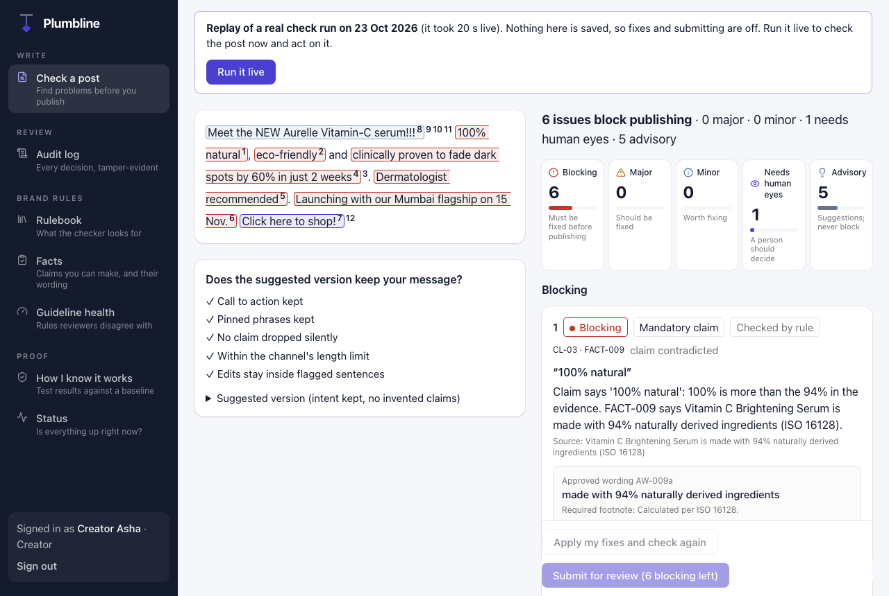
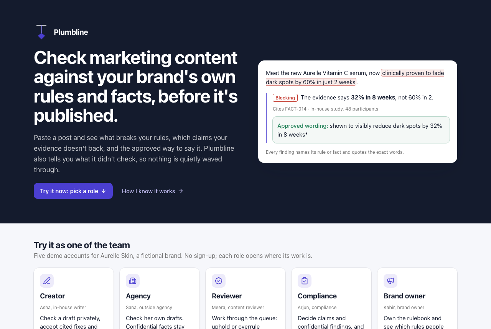
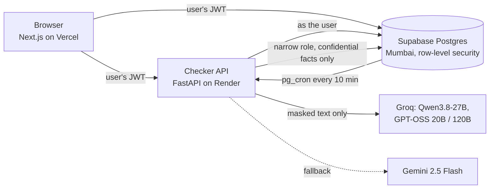

# Plumbline

**Check marketing content against your brand's own rules and facts, before it's published.**
Every finding cites the rule or fact it comes from and quotes the exact words; every check says what it
didn't check. On a 40-post dev set, Plumbline found **31 of 33** labelled problems (94%) where a
one-call AI baseline with the whole brand book found 18 (55%).

- **Live app:** https://getplumbline.xyz (pick a role; no sign-up)
- **How I know it works:** https://getplumbline.xyz/about
- **Status:** https://getplumbline.xyz/status
- **Checker API:** https://plumbline-checker.onrender.com/docs
- **In ASI:One chat:** the Agentverse agent "Plumbline Brand Checker"
  (`agent1qdec79g6x8dfjkvklj2gr9gwr28ggrk5julydls9e00mrsxct6rxcym5p4p`)
- **Round 3 PDF:** [docs/AtoZ_Plumbline_Round3.pdf](docs/AtoZ_Plumbline_Round3.pdf) (Round 3 and Round 2 progress, then the Round 1 plan unchanged)
- **Testing details:** [docs/testing.md](docs/testing.md) · **Roadmap:** [docs/roadmap.md](docs/roadmap.md) · **Features:** [docs/features.md](docs/features.md)

Demo runs on free model tiers using fictional data only; production uses paid no-training tiers or
self-hosted Qwen. Aurelle Skin is a fictional brand.



## The problem

Brand content now comes from employees, agencies, influencers and AI tools, and the brand book is a PDF
none of them reads at the moment of writing. India's ASCI found that **98% of the 7,199 ads it scrutinised
in FY2024-25 needed modification** (a complaint-driven sample, not a base rate), and since 2022 the CCPA's
guidelines make brands *and* endorsers liable for misleading claims, with penalties up to ₹10 lakh
(₹50 lakh for repeats). Sources and limits are in the [Round 1 plan](docs/round1/AtoZ_Plumbline_Round1_Plan.pdf) §1.

## What it does

- **Check** a pasted post, DOCX, PDF or image. Code rules (claims language, required disclosures,
  terms, contrast, alt text) run first; AI handles only judgement calls (tone, claims against the fact
  ledger). A finding is shown only if its rule or fact exists and its quote is really in the text.
- **Fix without inventing claims.** Claims are fixed only with approved wording from the fact ledger;
  other rewrites must pass five intent checks (call to action kept, pinned phrases kept, no claim
  dropped, length limit, edits only in flagged sentences).
- **Pre-check privately, then submit.** Pre-checks are private to the writer. Agencies never see
  confidential facts; their pre-checks say "Confidential checks run on submission."
- **Review and approve.** Risk-ordered queue; claims route to compliance; overruling a blocking finding
  needs a second approver, enforced in the database; every decision lands in a hash-chained audit log
  you can verify and export.
- **Check from chat.** The checker is also a Fetch.ai Agentverse agent, so it can be found and used
  in ASI:One: paste a post, get the same cited findings and approved wording back. It checks as an
  agency writer (confidential findings withheld), saves nothing, and allows 5 checks per sender per
  10 minutes.
- **Improve the guidelines.** Guideline health shows which rules reviewers keep overruling and which
  have earned the right to block (Wilson 95% lower bound of agreement ≥ 0.80). A brand rule that reaches
  that bound on at least 10 decisions moves to blocking by itself, with an audit entry and one-click undo
  (undo pins it until the owner releases it). For a rule that "may be unclear", Plumbline drafts a clearer
  wording, shows its score next to the old wording's, and changes nothing until the owner accepts.
- **Watch published claims.** When a fact expires or changes, every approved post that relied on it gets an
  update-or-withdraw task for its owner, with the approved replacement wording; registered live URLs are
  re-checked against the approved text.
- **Your brand in chat, and a publish gate.** A brand owner links a chat address with a one-time code so
  ASI:One checks use that brand's own rules and facts; scheduling and CMS tools call a gate API that
  answers "go" or "not yet" with reasons.



## How it works



1. **Parse** text, DOCX, PDF or image (Tesseract OCR, with colours sampled for contrast).
2. **Code checks**: 28 runnable rules, the term list, confidential and embargoed facts (matched in code,
   never sent to a model).
3. **AI checks**: claim extraction and judgement rules, with names, contacts and confidential facts
   masked first. Each call is logged by provider, model, region, purpose and size, never content.
4. **Validators**: the cited ID must exist and the quote must be in the text; a second model checks
   each AI finding, and disagreements go to "needs human eyes".
5. **Fixes and coverage**: approved-wording swaps, intent-locked rewrites, and a list of what wasn't
   checked. There is never a pass badge or score.
6. **Review and audit**: routed approvals, row-level security for every role, and an insert-only,
   hash-chained audit log written by database triggers.

| Part | Choice | Why |
|---|---|---|
| Web | Next.js 15, React 19, Tailwind, shadcn/ui | Server components for auth; deploys free on Vercel |
| Checker | Python 3.12, FastAPI, pydantic v2 | The parsing, OCR and NLP ecosystem is in Python |
| Database | Supabase Postgres + Auth | Row-level security does the permission model; triggers do the audit chain |
| Models | Qwen3.8-27B and GPT-OSS on Groq, Gemini Flash fallback | Open-weight first, so production can self-host; ₹0 on free tiers |
| Privacy | Presidio + spaCy, Indian-name gazetteer | Masks personal data before any model call |
| Parsing | python-docx, pdfplumber, Pillow, Tesseract | Permissive licences (no AGPL) |

More detail: [features and status](docs/features.md) · [changes from Round 1](docs/changes-from-round1.md) ·
[Round 3 improvements](docs/round3-improvements.md) · [desk research](docs/desk-research.md) ·
[build log](docs/build-log.md) (an evaluation of
every task, with each assumption that failed and what replaced it).

## How I know it works

Measured on a 40-post dev set written for this project (25 labelled posts with 33 problems, 10 clean
controls, 5 prompt-injection copies); its labels were frozen before any model run. A finding counts only if it names the right rule or fact **and** points at
the right words. The baseline is one model call per post with the whole brand book and no validators.

| Metric | Plumbline | Baseline |
|---|---|---|
| Problems found (recall) | **31 / 33 = 94%** (95% CI 80–98%) | 18 / 33 = 55% (38–70%) |
| Findings that were right (precision) | **31 / 39 = 79%** (64–89%) | 18 / 37 = 49% (33–64%) |
| Clean posts with a false alarm | **1 / 10** | 4 / 10 |
| Characters sent to models | 243k | 634k |

- **A negative result:** "citations that check out" was 100% for *both*. The baseline cites real IDs
  and real quotes, just the wrong ones, so that metric can't tell them apart here; precision does.
- Two of Plumbline's 8 false alarms are plain errors (an approved fact reported as unsupported on a
  clean post). Labels were frozen before the AI runs, so defensible extra findings also count against it.
- Tests: 323 checker unit tests, 40 database tests (RLS, audit chain, second approver, link codes, gate keys,
  graduation), 19 end-to-end tests run against the live site ([details](docs/testing.md)). Each live run and measurement is in the [build log](docs/build-log.md).
- Speed on Render's free tier: text checks 1.8–3.6 s; image checks about 6 s (OCR alone is ~3.8 s on
  the shared CPU).

### Round 3 results

| Improvement | Measure | Result |
|---|---|---|
| 1 Claim watch + regulator rulings | Recall on upheld claims, 41 ASA/ASCI rulings (target ≥ 80%) | **72 of 81 = 88.9%** ([details](docs/ruling-eval.md)) |
| 1 Second brand by CSV | Kora (fictional fintech): planted problems caught; clean posts blocked | 27 of 30; 0 of 10 ([details](docs/second-brand.md)) |
| 3 Self-learning guidelines | Drafted wording vs old wording on rulings it was not written from (target: beats it) | **Not met**: 65 of 84 vs 63 and 66 ([details](docs/clarify-eval.md)) |
| 1 Citations | 100 findings checked by the builder (target ≥ 95%) | run 1: 93; after two fixes, fresh sample: **98** ([details](docs/citation-check.md)) |
| 1 and 2 Fix audit | the 64 fixes the test posts produce (target 0 invented) | pending the builder's check |

## Limits

- The dev set was written for this project, not drawn from real posts, and it is small, so the
  intervals are wide. Round 3 added a held-out set from public ASCI and UK ASA rulings, where the
  regulator's verdict is the label, and a second brand loaded by CSV.
- No primary research or user study: the interviews, survey, raters, labellers and user tests planned in
  Round 1 need recruited participants, which a one-person team can't run in a hackathon. The evidence plan
  moved to sources anyone can verify instead
  ([how and why](docs/changes-from-round1.md#how-the-evidence-plan-changed-and-why)), and hypotheses
  H1–H6 were checked against published surveys ([desk research](docs/desk-research.md)).
- Image checks miss the 5 s target on the free CPU; claims inside images aren't checked yet.
- Guideline-health history is synthetic and labelled as such in the app; automatic graduation counts it too and
  records how many of its decisions were sample.
- Drafted rule clarifications did not beat the old wording in the replay, so they are proposals for the owner,
  not improvements we claim.
- Free model tiers may use inputs for training, which is why the demo uses fictional data only.

## Run it

The live link above needs nothing installed. To run it yourself you need two Supabase projects
(app and test), a Groq key and a Gemini key, written to a `secrets.env` outside the repo
(see [`.env.example`](.env.example)).

```bash
make env          # write the gitignored env files from secrets.env
make db-push      # apply supabase/migrations
make seed         # load the fictional Aurelle Skin data and demo users
make dev-checker  # FastAPI on :8000   (in one terminal)
make dev-web      # Next.js on :3000   (in another)
make test         # checker unit tests; `make test-db` and `make e2e` for the rest
make eval         # rerun the evaluation (spends real model calls)
```

## AI-use disclosure

I built Plumbline with **Claude Code** (Anthropic) as a coding assistant: it drafted code, tests and
documentation under my direction. I chose the product and its design, decided each trade-off, reviewed
the changes, ran and judged every evaluation, and am the sole author of every commit. At runtime,
Plumbline itself uses open-weight models on Groq (Qwen3.8-27B, GPT-OSS 20B and 120B) with Google's
Gemini 2.5 Flash and Fetch.ai's ASI:One (asi1-mini) as fallbacks, on fictional data only. The evaluation's dev set and the fictional Aurelle
data were drafted with the assistant; the dev set's labels were frozen before any model was run on it.

## Photo credits

The landing page's sample content uses free photos from [Unsplash](https://unsplash.com/license), shown
as a fictional brand's ads; none of them shows a real brand:
[amber serum on orange](https://unsplash.com/photos/GjJZ5HBl2qQ),
[serum in shadow](https://unsplash.com/photos/GDSNp1RJyLE),
[textures on glass](https://unsplash.com/photos/QbHwPe1HE84),
[textures with leaves](https://unsplash.com/photos/g6q3lFAe3kA),
[applying serum](https://unsplash.com/photos/7LAbLSKbkaQ),
[cream jar](https://unsplash.com/photos/k2JN5zC54zQ),
[pink lip gloss](https://unsplash.com/photos/QM77NRAFVOg).
